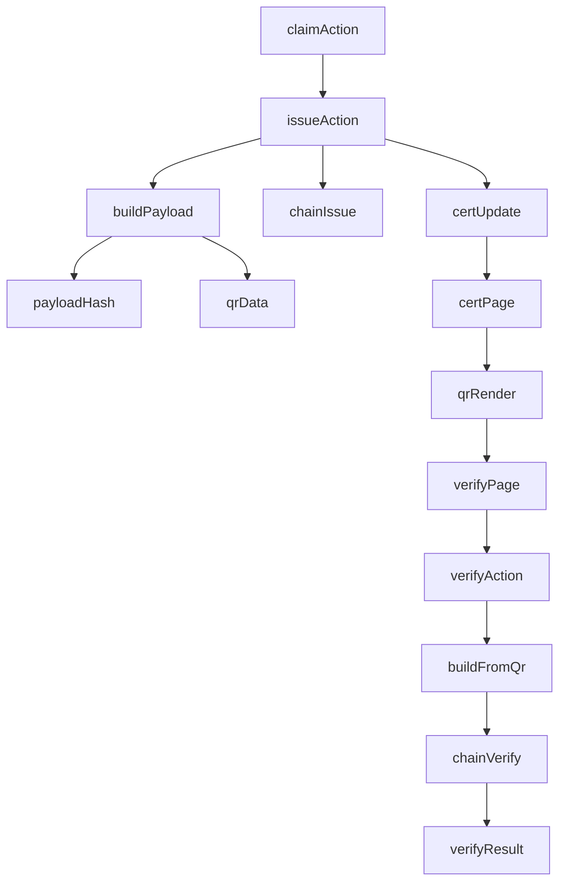

# QR Tamper-Proof Certificate Upgrade Plan

## Scope and Constraints

- Keep certificate creation semantics as `upsert` (no `create()` conversion).
- Update both creation points: [app/actions/claim-certificate.ts](app/actions/claim-certificate.ts) and [lib/certificate-emails.ts](lib/certificate-emails.ts).
- Reuse existing QR component [app/dashboard/certificate/[slug]/CertificateQRCode.tsx](app/dashboard/certificate/[slug]/CertificateQRCode.tsx) and fallback to verification URL for legacy certs.
- Use `recipientName` as canonical name snapshot; do not add `studentName` field.
- Do not touch smart contract/typechain files.
- Keep print flow unchanged via [app/dashboard/certificate/[slug]/CertificatePrintButton.tsx](app/dashboard/certificate/[slug]/CertificatePrintButton.tsx).

## Phase 1: Baseline Files (already reviewed)

- [app/actions/claim-certificate.ts](app/actions/claim-certificate.ts)
- [app/actions/issue-certificate.ts](app/actions/issue-certificate.ts)
- [app/actions/verify-certificate.ts](app/actions/verify-certificate.ts)
- [app/dashboard/certificate/[slug]/CertificateQRCode.tsx](app/dashboard/certificate/[slug]/CertificateQRCode.tsx)
- [app/dashboard/certificate/[slug]/CertificateTemplate.tsx](app/dashboard/certificate/[slug]/CertificateTemplate.tsx)
- [app/dashboard/certificate/[slug]/page.tsx](app/dashboard/certificate/[slug]/page.tsx)
- [app/verification/page.tsx](app/verification/page.tsx)
- [lib/certificate-emails.ts](lib/certificate-emails.ts)

## Phase 2: Prisma Schema + Migration Command (no execution yet)

- Add to `Certificate` model in [prisma/schema.prisma](prisma/schema.prisma):
  - `qrData String? // JSON string embedded in QR code`
- Migration command to run later (not now):
  - `pnpm prisma migrate dev --name add_qr_data_to_certificate`

## Phase 3: Blockchain Utility Updates

- In [lib/blockchain.ts](lib/blockchain.ts):
  - Extend `buildCertificatePayload(...)` return type to include `qrData`.
  - Build `qrData` using compact keys `{ n, c, d, id }` from issuance snapshot values.
  - Keep canonical hash payload logic unchanged (same fields, same canonicalization via `stableStringify`).
  - Add exported `buildPayloadFromQR(qrData)` to parse QR JSON and reconstruct `payloadHash` from parsed snapshot data.

## Phase 4: Issuance Path Changes

- In [app/actions/issue-certificate.ts](app/actions/issue-certificate.ts):
  - Consume `{ payloadHash, qrData }` from `buildCertificatePayload(...)`.
  - Persist `qrData` in existing `prisma.certificate.update(...)` alongside blockchain fields.
  - Keep existing on-chain status and print-related fields intact.
- In [app/actions/claim-certificate.ts](app/actions/claim-certificate.ts):
  - In `upsert.create`, initialize `recipientName` from user snapshot (fallback-safe).
  - Ensure issuance input uses `certificate.recipientName ?? user.name ?? ""` for payload snapshot consistency.
- In [lib/certificate-emails.ts](lib/certificate-emails.ts):
  - In certificate upsert create/update path, ensure `recipientName` is initialized/preserved where missing.
  - Align issuance/hash snapshot source to `recipientName` semantics when triggering issuance-related logic.

## Phase 5: QR Rendering Updates

- In [app/dashboard/certificate/[slug]/CertificateQRCode.tsx](app/dashboard/certificate/[slug]/CertificateQRCode.tsx):
  - Change prop from URL-centric to `qrData`-centric (with fallback value support).
  - Keep existing QR size/colors/styling untouched.
- In [app/dashboard/certificate/[slug]/CertificateTemplate.tsx](app/dashboard/certificate/[slug]/CertificateTemplate.tsx):
  - Pass `cert.qrData` (or provided fallback verification URL) into `CertificateQRCode`.
- In [app/dashboard/certificate/[slug]/page.tsx](app/dashboard/certificate/[slug]/page.tsx):
  - Include `qrData` in certificate query/select and pass through to template.

## Phase 6: Verification Logic (dual mode)

- Replace logic in [app/actions/verify-certificate.ts](app/actions/verify-certificate.ts) to support:
  - `mode: "qr"` using raw QR JSON input and hash rebuild from QR snapshot.
  - `mode: "id"` fetching cert by `uniqueId`, then deriving hash from stored `cert.qrData`.
- Use `buildPayloadFromQR(...)` + `verifyCertificateOnChain(...)` for both modes.
- Return explicit errors for:
  - invalid input,
  - missing cert,
  - not-yet-issued cert,
  - legacy cert missing `qrData`,
  - tamper/hash mismatch.

## Phase 7: Verification Page Wiring

- In [app/verification/page.tsx](app/verification/page.tsx):
  - Update all calls to new signature: `verifyCertificate({ mode: "id", uniqueId })`.
  - Handle query params:
    - `?cid=...` => mode `id`
    - `?qr=...` => mode `qr`
  - Keep existing UI layout/visuals unchanged.
  - Add clear tamper warning rendering path when error text indicates tampering.

## Phase 8: Pre-Apply Diff Review + Implementation Sequence

- Before applying changes, present per-file diff previews for all touched files:
  - [prisma/schema.prisma](prisma/schema.prisma)
  - [lib/blockchain.ts](lib/blockchain.ts)
  - [app/actions/issue-certificate.ts](app/actions/issue-certificate.ts)
  - [app/actions/claim-certificate.ts](app/actions/claim-certificate.ts)
  - [lib/certificate-emails.ts](lib/certificate-emails.ts)
  - [app/dashboard/certificate/[slug]/CertificateQRCode.tsx](app/dashboard/certificate/[slug]/CertificateQRCode.tsx)
  - [app/dashboard/certificate/[slug]/CertificateTemplate.tsx](app/dashboard/certificate/[slug]/CertificateTemplate.tsx)
  - [app/dashboard/certificate/[slug]/page.tsx](app/dashboard/certificate/[slug]/page.tsx)
  - [app/actions/verify-certificate.ts](app/actions/verify-certificate.ts)
  - [app/verification/page.tsx](app/verification/page.tsx)

## Phase 9: Validation Checklist (post-apply)

- Type-check/lint changed files only and resolve introduced errors.
- Validate behavior:
  - claim-certificate saves `recipientName` and `qrData`
  - secondary creation path remains consistent
  - QR contains snapshot JSON
  - verification works in both `id` and `qr` modes
  - profile name changes do not invalidate existing cert
  - tampered QR fails with clear message
  - legacy certs get helpful missing-QR error
  - print button flow still works

## Data Flow (post-change)

