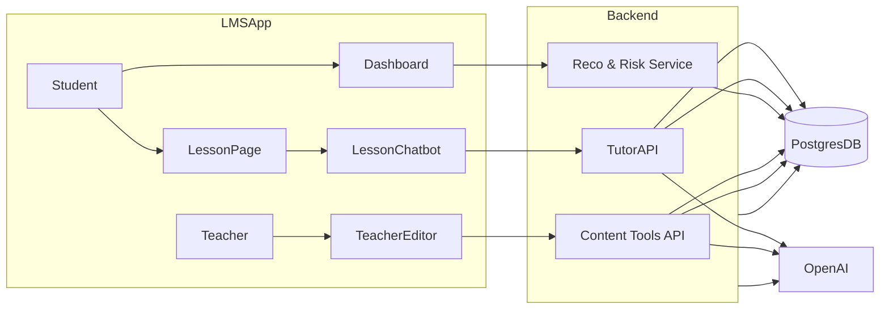

## Scope

This document describes the first wave of AI features for the LMS, based on three priority areas:

- **Course-level AI tutor (Q&A over course materials)**
- **Personalized recommendations & early-warning for at-risk learners**
- **AI-assisted content tools for instructors (quiz/summary generator)**

It builds on the existing OpenAI integration (`lib/openai`), lesson transcripts, and the current tutor implementation under `app/api/tutor`.

## 1. Course-Level AI Tutor (Current & Next)

### 1.1 Current Implementation (Baseline)

- **Frontend**
  - `components/dashboard/LessonChatbot.tsx` mounts an AI tutor panel on the lesson page.
  - It calls:
    - `POST /api/tutor/chat` for sending a question.
    - `GET /api/tutor/history` for loading previous messages.
    - `DELETE /api/tutor/history` for clearing history.

- **Backend**
  - `app/api/tutor/chat/route.ts`:
    - Authenticates the user (Better Auth).
    - Rate-limits requests (Arcjet).
    - Fetches:
      - `Lesson` (title, transcript, `transcriptionSegments`, `Chapter`, `Course`, `Enrollment`).
      - Existing `TutorChat` (messages, OpenAI response id).
    - Uses `parseWhisperSegments` + `formatTranscriptWithTimestamps` from `lib/tutor-context.ts` to build a **timestamped transcript**.
    - Calls `buildTutorSystemPrompt` with:
      - `LessonContext` (course, chapter, lesson titles).
      - Transcript segments (full or windowed).
      - `TutorState` (first interaction, introCompleted, studentIntro, studentName).
    - Streams a response from `openai.responses.create` (`gpt-4o-mini`) with optional `previous_response_id`.
    - Persists question/answer in `TutorChat` and `TutorMessage`.
    - Stores an enrollment-level `studentIntro` to reuse across course lessons.
  - `app/api/tutor/history/route.ts`:
    - Returns paginated chat history for a lesson.
    - Resolves effective intro (course-level vs chat-level).
    - Supports clearing history.
  - `lib/tutor-context.ts`:
    - Normalizes Whisper segments and keeps a cached, timestamped transcript.
    - Builds the system prompt considering:
      - Current lesson context.
      - Transcript window around the current video timestamp.
      - Student name and intro.

- **Data Model (Prisma)**
  - `Lesson`:
    - `transcript`, `transcriptionSegments`, `videoSummary`, `tutorChats`.
  - `User`:
    - `tutorChats`.
  - `TutorChat` / `TutorMessage` (see schema) store AI conversations.
  - `Enrollment`:
    - `studentIntro` (per-course personalization).

### 1.2 Tutor 2.0: Richer Context & Behavior

Goal: Turn the existing per-lesson tutor into a **richer, course-aware assistant** that can also draw from attachments and basic learner analytics while staying simple to maintain.

#### 1.2.1 Additional Context Sources

Use existing data to enrich the tutor prompt:

- **Lesson structure & course outline**
  - Extend the tutor query to also load:
    - Sibling lessons in the same chapter.
    - Chapter order within the course.
  - Use this to:
    - Place the current lesson within a larger learning path.
    - Allow the tutor to say things like:
      - “This concept is built on Lesson 3: Variables.”
      - “You’ll see this again in Lesson 7 when we discuss inheritance.”

- **Attachments & PDFs**
  - From `LessonAttachment` (file name + key), identify:
    - PDFs with additional notes.
    - Problem sheets or slides.
  - For now, use a simple approach:
    - Add a short attachment summary field to `LessonAttachment` (generated via OpenAI when new attachments are uploaded).
    - Include those summaries in the system prompt as extra reference text.

- **Lesson summaries**
  - Reuse `videoSummary` generated by `generateLessonSummary(lessonId)` as a compact description of the lesson.
  - Include it in the system prompt (before the full transcript snippets) to give the model a “bird’s eye view” of the lesson.

- **Progress signals (lightweight)**
  - From `LessonProgress`:
    - `watchPercentage`, `watchedDuration`, `videoDuration`, `completed`.
  - From `QuizAttempt`:
    - Whether a quiz exists for the lesson and if the student has passed it.
  - Use this to:
    - Let the tutor adapt its explanations:
      - If watch percentage is low, assume less context and explain from first principles.
      - If the student repeatedly fails a quiz, the tutor can use more examples and check understanding.

Implementation note: all of this can be added as **extra metadata inside the system prompt** (no model changes needed).

#### 1.2.2 Prompt Structure (High-Level)

- **System prompt sections**:
  - Course + lesson summary.
  - Short course outline snippet (titles of previous/next lessons).
  - Key attachments summary.
  - Student profile:
    - Name.
    - `studentIntro` (goals/background).
    - High-level progress (e.g. “Watched 60% of this video, hasn’t passed quiz yet.”).
  - Timestamped transcript window around `videoTimestamp`.

- **Model call**
  - Continue using `gpt-4o-mini` via `openai.responses.create`.
  - Maintain `previous_response_id` for improved coherence.

No new endpoints are required; this is an evolution of `buildTutorSystemPrompt` and the prisma query in `app/api/tutor/chat/route.ts`.

## 2. Personalized Recommendations & Early Warning

### 2.1 Available Signals (Prisma Models)

Key tables and fields to use:

- `Enrollment`
  - `status` (Active / Pending / etc.).
  - `createdAt`, `updatedAt`.
  - Course-level `studentIntro`.
- `LessonProgress`
  - `completed`, `watchPercentage`, `watchedDuration`, `videoDuration`.
  - Last watched position & timestamps (`createdAt`, `updatedAt`).
- `QuizAttempt`
  - `score`, `isCompleted`, `startedAt`, `submittedAt`, `timeSpent`.
  - Per-attempt behavior (backButtonCount, tabSwitchCount, etc.).
- `Review`
  - `rating`, `text` as implicit satisfaction signal.

These are sufficient for a **first, non-ML iteration**.

### 2.2 At-Risk Learner Scoring (Rule-Based v1)

Create a small scoring function per `(user, course)` that outputs:

- **riskScore**: 0–100.
- **riskReasons**: list of human-readable reasons.

High-level rules (example starting point):

- **Engagement**
  - Low recent activity:
    - If no `LessonProgress.updatedAt` in last N days (e.g. 7), +20 risk.
  - Low watch progression:
    - If average `watchPercentage` across started lessons < 30% after 1 week, +15 risk.

- **Assessment performance**
  - If last 2 `QuizAttempt` scores < passing threshold (e.g. 60%), +20 risk.
  - If `isCompleted` is false for many attempts or many abandoned attempts, +10 risk.

- **Course completion**
  - If course is >50% through calendar-wise (relative to enrollment date) but:
    - Completed lessons < 25%: +20 risk.

Implementation sketch:

- Add a `getLearnerRiskForCourse(userId, courseId)` server function under `app/data/dashboard/` (or similar).
- Add `getAtRiskLearnersForTeacher(teacherId)` for teacher/admin dashboards.
- Expose via API route or use directly in server components for dashboards.

### 2.3 Recommendation Logic (v1, Rule-Based)

Types of recommendations:

- **Inside a course (micro)**
  - Next lesson to watch based on:
    - `LessonProgress.completed` and `position`.
    - Recommend:
      - The next incomplete lesson in the current chapter.
      - Optionally, a quick recap lesson before a difficult quiz.

- **Across courses (macro)**
  - For a logged-in learner:
    - Courses in categories they’re already enrolled in.
    - Higher-level courses in the same category and level progression (Beginner → Intermediate → Advanced).
  - Use:
    - `Course.category`, `Course.level`, `Enrollment`.

Implementation sketch:

- Add server functions such as:
  - `getNextLessonRecommendations(userId, courseId)`.
  - `getCourseRecommendations(userId)`.
- Use simple SQL/Prisma queries (no vectors/embeddings needed initially).
- Surface in:
  - Student dashboard (`app/dashboard/page.tsx`).
  - Per-course dashboard sidebar (`app/dashboard/_components/CourseSidebar.tsx`).

## 3. AI-Assisted Content Tools for Instructors

### 3.1 Quiz Generator from Lesson Transcript

Goal: Allow teachers to quickly generate draft quizzes based on a lesson transcript, then review and edit before publishing.

Inputs:

- `lessonId`.
- Optional: desired number of questions, difficulty, and question types (MCQ, short answer).

Data used:

- `Lesson.transcript` (truncated for context if very long).
- `Course` + `Chapter` titles for context.

High-level behavior:

- Call OpenAI with an instruction prompt such as:
  - “Generate N quiz questions (with answers) based on this transcript. Output as JSON schema: [{question, options[], correctOptionIndex, explanation}].”
- Parse the JSON response and create:
  - `Quiz` + `QuizQuestion` + `QuizOption` records via Prisma.
- Mark quiz as `isPublished: false` so teachers can edit first.

Suggested placement:

- New teacher-only action in the lesson editor (e.g. in `app/teacher/courses/[courseId]/[chapterId]/[lessonId]/_components/TeacherLessonForm.tsx`):
  - “Generate quiz from lesson transcript”.

### 3.2 Flashcard & Summary Generator

Reuse the same transcript + OpenAI to:

- Generate:
  - 10–20 flashcards (`front`, `back`) for spaced repetition.
  - Bullet-point summaries aligned with learning objectives.
- Store flashcards in a new table (if needed) or as JSON field on `Lesson`.
- Surface them on:
  - Lesson dashboard tab: “Flashcards”.

### 3.3 Localization & Accessibility Helpers

Extend existing OpenAI usage to:

- Translate:
  - `Course.description`, `Lesson.description`, quiz questions and options to target languages.
- Improve accessibility:
  - Generate alt-text suggestions for lesson thumbnails and attachments.

These can start as **on-demand tools** in the teacher interface rather than automatic processes.

## 4. High-Level Data & Flow Diagram

## 5. Next Steps

- Implement tutor context enrichment (attachments, summaries, progress signals) by extending:
  - Prisma queries in `app/api/tutor/chat/route.ts`.
  - Prompt construction in `lib/tutor-context.ts`.
- Implement rule-based risk and recommendation functions as server-side utilities and wire them into dashboards.
- Add teacher UI actions + APIs for quiz and flashcard generation, using the existing OpenAI client and lesson transcripts.

