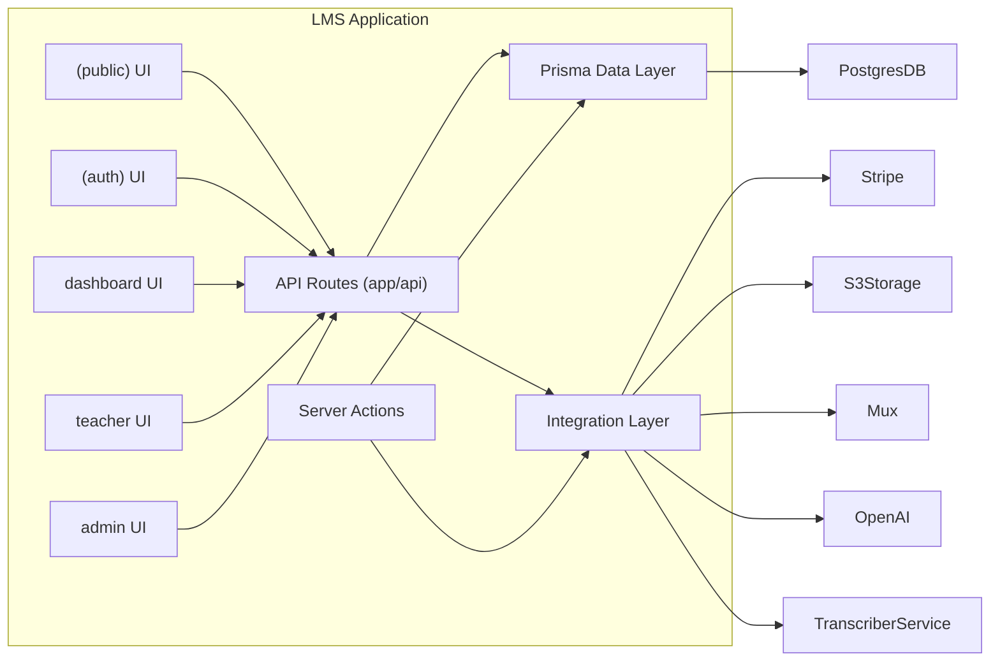
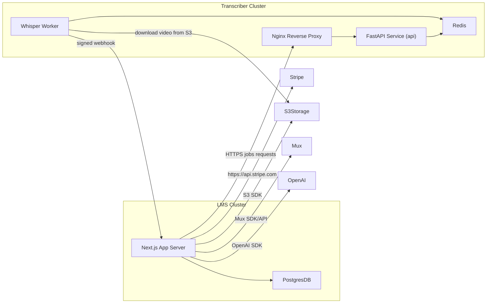
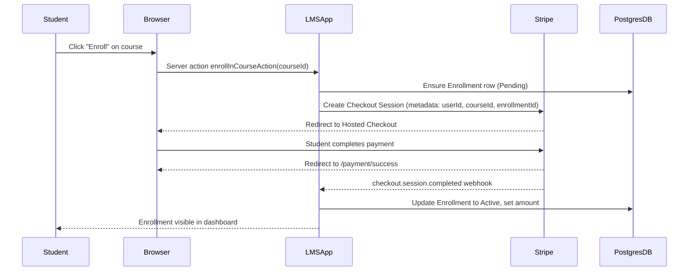
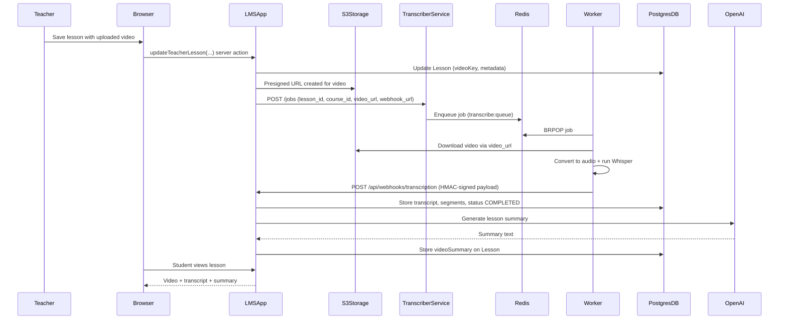
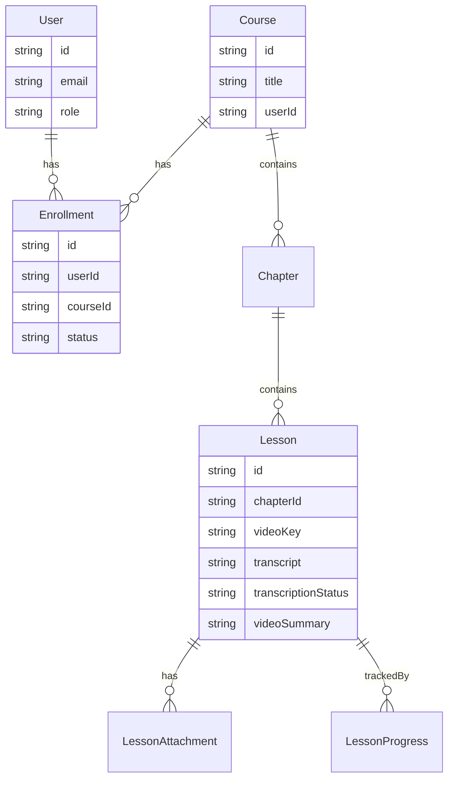

## 1. Introduction & Objectives

Edris LMS is a modern, full‑stack Learning Management System built with Next.js, React, TypeScript, Prisma, and PostgreSQL. It targets three primary user groups: **students**, **teachers**, and **administrators**, and provides an end‑to‑end e‑learning experience including course catalog, enrollment and payments, content delivery, assessments, communities, and progress tracking.

As part of this final‑year project (FYP), the LMS is extended with an **AI‑powered transcription and summarisation pipeline**. Teachers can upload lecture videos; a dedicated transcription microservice (based on Python, FastAPI, Redis, Whisper, and Docker) asynchronously generates accurate transcripts and sends them back to the LMS, which persists them, generates AI summaries using OpenAI, and exposes them to students.

The main objectives of the system are:
- **Accessibility**: Provide text transcripts and summaries for video content, improving accessibility for students with hearing impairments and for learners who prefer reading or searching content.
- **Rich LMS feature set**: Offer standard LMS features such as course management, enrollments, quizzes, communities, certificates, and analytics.
- **Scalability & robustness**: Separate heavy audio/video processing into a dedicated microservice with a queue and worker model, allowing the LMS to remain responsive under load.
- **Security & reliability**: Implement secure authentication, role‑based access control, secure payment processing, rate limiting, and cryptographically signed webhooks between the LMS and the microservice.

Target users:
- **Students**: consume learning content, watch videos, read transcripts/summaries, participate in communities, complete assignments and quizzes.
- **Teachers**: design and manage courses, upload videos and materials, monitor student progress, and interact with students.
- **Admins**: manage the platform, approve teachers, moderate content, observe analytics, and enforce policies.

## 2. High‑Level System Overview

At a high level, the system consists of:
- **Edris LMS Web Application** (`edris-lms-fyp`):
  - Next.js 15 (App Router) application that serves:
    - Public marketing and course catalog (`app/(public)`).
    - Auth pages (`app/(auth)`).
    - Student dashboard (`app/dashboard`).
    - Teacher portal (`app/teacher`).
    - Admin portal (`app/admin`).
  - Backend APIs implemented as Next.js API routes under `app/api/*`, plus server actions co‑located with UI.
  - Data layer using Prisma and PostgreSQL.
  - Integrations with Stripe (payments), AWS S3/Tigris (storage), Mux (video streaming), OpenAI (AI summaries and tutor), and the transcription microservice.

- **Transcription Microservice** (`MICROSERVICE`):
  - Python‑based FastAPI HTTP service for receiving transcription jobs.
  - Redis‑backed worker process running Whisper and FFmpeg to perform heavy transcription work.
  - Docker Compose / Nginx‑based deployment fronted by `transcriber.edrislms.com`.
  - Communicates with the LMS via HTTP (`/jobs` and a signed webhook back to `/api/webhooks/transcription`).

- **External services**:
  - **PostgresDB**: primary relational database for LMS data.
  - **Stripe**: payment processor for course purchases.
  - **S3Storage** (Tigris‑compatible): object storage for videos and lesson files.
  - **Mux**: video streaming platform that ingests S3‑stored videos and serves HLS playback to students.
  - **OpenAI**: used to generate lesson summaries and power an AI tutor feature.
  - **Redis**: in‑memory data store for the transcription queue, used only by the microservice.

### 2.1 System Context Diagram

```mermaid
flowchart LR
  Student -->|uses| LMSApp
  Teacher -->|uses| LMSApp
  Admin -->|uses| LMSApp

  LMSApp -->|reads/writes| PostgresDB
  LMSApp -->|stores files| S3Storage
  LMSApp -->|payments| Stripe
  LMSApp -->|create assets| Mux
  LMSApp -->|AI summaries & tutor| OpenAI
  LMSApp -->|submit jobs (Bearer token)| TranscriberService

  TranscriberService -->|queue & status| Redis
  TranscriberService -->|download video| S3Storage
  TranscriberService -->|"webhook (HMAC)"| LMSApp
```

In words:
- Users interact with the **LMSApp**, which in turn manages **PostgresDB** data, communicates with **Stripe** for payments, stores large files in **S3Storage**, manages streaming via **Mux**, and uses **OpenAI** for summarisation and tutoring.
- For transcription, LMSApp sends a **signed job request** to **TranscriberService**, which queues work in **Redis**, downloads the video from S3, runs Whisper, and calls back a **signed webhook** to LMSApp with the transcript.

## 3. Functional Requirements (Summary)

### 3.1 Student‑facing features
- **Course discovery**: browse published courses, view details (description, curriculum, teacher info, price).
- **Enrollment & payments**:
  - Add individual courses or multiple courses (cart) to purchase.
  - Pay securely through Stripe Checkout.
  - See list of enrolled courses and their progress in the dashboard.
- **Content consumption**:
  - Watch video lessons streamed via Mux.
  - Download/view lesson attachments (PDFs, documents) via signed S3 URLs.
  - View **transcripts** and **AI‑generated summaries** associated with lessons.
- **Assessments & engagement**:
  - Take quizzes and submit assignments.
  - Participate in communities and forums (posts, comments).
  - Request support or open tickets where implemented.

### 3.2 Teacher‑facing features
- **Course creation & management**:
  - Create/edit courses, chapters, and lessons.
  - Upload videos (stored in S3) and lesson attachments.
  - Configure lesson types (video vs reading), quizzes, and assignments.
- **Transcription automation**:
  - When a lesson with a `videoKey` is saved, the system:
    - Creates/updates a Mux asset for streaming.
    - Automatically triggers a transcription job to the microservice.
  - Teachers do not interact with the microservice directly; it is transparent.
- **Analytics & student management**:
  - View enrollments and student progress per course.
  - Engage in communities and respond to student questions.

### 3.3 Admin‑facing features
- **User and teacher management**:
  - View and manage users, including banning/unbanning and role changes.
  - Review and approve/reject teacher applications with reasons.
- **Course and catalog management**:
  - Manage course listings, visibility, and possibly pricing.
- **Platform analytics**:
  - Access usage metrics (enrollments, revenue, active users), with room for future expansion.
- **Platform configuration** (partially implemented):
  - Manage high‑level settings and moderation workflows.

### 3.4 Transcription‑specific requirements
- Automatic transcription of teacher videos when lessons are saved with a `videoKey`.
- Asynchronous processing so that the LMS remains responsive.
- Secure communication between LMS and microservice:
  - Bearer token for `/jobs` endpoint.
  - HMAC‑signed webhooks for callbacks.
- Idempotent / duplicate‑safe behaviour:
  - Multiple calls to enqueue a job for the same lesson should not create duplicate processing work.
- Persisted transcripts and AI summaries on lessons, exposed in the student UI.

## 4. Non‑Functional Requirements

- **Performance**:
  - The LMS must handle concurrent access from many students per course.
  - Video uploads can be large; uploads happen directly to S3‑compatible storage, offloading the LMS server.
  - Transcription throughput is bounded by the microservice’s worker capacity and hardware but must not block LMS operations.
- **Scalability**:
  - LMS is stateless at the application layer (sessions stored in Postgres), allowing horizontal scaling.
  - The transcription service is independently scalable: multiple workers can consume from the same Redis queue.
- **Security**:
  - Strong authentication and session management via Better‑Auth + Prisma.
  - Role‑based access control across student, teacher, and admin areas.
  - Rate limiting and bot detection on signup routes via Arcjet.
  - Cryptographically signed webhooks between microservice and LMS.
  - SSRF protections in the microservice when validating `video_url` and `webhook_url`.
- **Reliability & fault tolerance**:
  - Redis‑backed queue with retry and failure handling for transcription jobs.
  - Idempotent job creation for lessons already queued/processing.
  - Robust webhook handling: transcription results are stored even if initial UI rendering fails; jobs may be retried when webhook delivery fails.
- **Maintainability**:
  - Clear separation of concerns: UI, API routes, data access layer, and external integrations in the LMS; API and worker split in the microservice.
  - Type‑safe data access via Prisma and typed environment variables.

## 5. Detailed Architecture

### 5.1 Component View (LMS‑centric)

Key LMS components:
- **Web frontends**:
  - `app/(public)`: landing, marketing, and public course pages.
  - `app/(auth)`: login, signup, and OTP flows.
  - `app/dashboard`: student dashboard and course consumption.
  - `app/teacher`: teacher course and content management.
  - `app/admin`: admin portal for platform management.

- **API layer** (Next.js API routes under `app/api/*`):
  - `app/api/auth/[...all]`: Better‑Auth endpoints wrapped with Arcjet protection.
  - `app/api/webhook/stripe`: Stripe webhook for payment events.
  - `app/api/webhooks/transcription`: webhook endpoint for transcription results.
  - S3/Tigris helpers: endpoints for generating signed URLs for uploads and downloads.
  - Mux integration endpoints: creating assets and webhooks from Mux.
  - Tutor and analytics endpoints for advanced features.

- **Data access layer**:
  - `lib/db.ts`: Prisma client instance.
  - `prisma/schema.prisma`: schema for users, courses, lessons, enrollments, quizzes, communities, tutor chat, etc.

- **Integration layer**:
  - `lib/auth.ts`: Better‑Auth configuration with Prisma adapter and OTP/Google providers.
  - `lib/stripe.ts`: Stripe client and helpers.
  - `lib/S3Client.ts`: AWS S3/Tigris client wrapper.
  - `lib/mux.ts`: Mux client and signed playback URL helpers.
  - `lib/transcription.ts`: orchestration of transcription job submission and HMAC verification for webhooks.
  - `lib/generate-summary.ts`: OpenAI integration to summarise lesson transcripts.

#### 5.1.1 Component Diagram



### 5.2 Deployment View

In a typical deployment, the system is split into two logical clusters: one for the LMS and one for the transcription microservice.



### 5.3 Data Flow View (End‑to‑End)

High‑level flows:
- **Signup/Login**: Browser → LMS auth routes (Better‑Auth + Arcjet) → Postgres.
- **Enrollment/Payment**: Browser → LMS server action → Stripe Checkout → Stripe webhook → Postgres.
- **Video Upload & Playback**: Teacher UI → S3 (via signed URLs) → Mux asset creation → Student playback via Mux.
- **Transcription**: Teacher UI → LMS server action → microservice `/jobs` → Redis queue → worker → LMS webhook → Postgres → OpenAI summary.

#### 5.3.1 Sequence: Enrollment & Payment



#### 5.3.2 Sequence: Video Transcription



## 6. Detailed Workflows

### 6.1 User Signup & Login

- LMS uses **Better‑Auth** with a **Prisma adapter** to manage users, sessions, accounts, and OTP verification.
- The `/api/auth` route is wrapped by **Arcjet**, which:
  - Validates email format and MX records.
  - Blocks disposable or obviously invalid email domains.
  - Performs bot detection and rate limiting, especially on the signup endpoint.
- On success, Better‑Auth issues a session stored in Postgres. The login page then:
  - Looks up the user’s **role** (`admin`, `teacher`, or default student) and `teacherStatus`.
  - Redirects admins to `/admin`, active teachers to `/teacher`, and others to `/dashboard`.

### 6.2 Course Creation & Content Management

- Teachers create courses which contain chapters and lessons.
- For each lesson, teachers can:
  - Define lesson metadata (title, description, type).
  - Attach resources (PDFs, documents) and optionally a video.
  - Use signed S3 URLs to upload video files directly to storage.
- The teacher actions are implemented as server actions and API routes that:
  - Validate ownership (only the teacher who owns the course can modify it).
  - Use Prisma to create/update `Course`, `Chapter`, `Lesson`, `LessonAttachment`, and related models.

### 6.3 Enrollment & Payments Workflow

- When a student clicks “Enroll”, a server action:
  - Confirms the user is authenticated.
  - Applies Arcjet rate limiting to avoid abuse.
  - Ensures a Stripe customer exists and is linked to the user’s record.
  - Within a database transaction:
    - Creates or updates an `Enrollment` row for that course with status `Pending`.
    - Creates a Stripe Checkout Session for either a single course or multiple courses (cart).
- Stripe hosts the payment page and, after payment:
  - Redirects the user to a success page in the LMS.
  - Sends a `checkout.session.completed` webhook back to LMS.
- The webhook handler:
  - Verifies Stripe’s signature.
  - Updates the `Enrollment` row(s) to `Active` and records the amount paid.
  - Clears cart items for cart‑based checkouts.

### 6.4 Video Upload, Streaming & Transcription

- Teachers upload videos using signed S3 URLs; the resulting object key is saved as `videoKey` on the `Lesson`.
- When the lesson is saved:
  - The LMS calls a Mux integration endpoint which:
    - Uses a presigned S3 URL to create a Mux asset.
    - Stores `muxAssetId`, `muxPlaybackId`, and status on the lesson.
  - The LMS also calls `triggerTranscriptionForLesson`:
    - Determines the base URL for internal callbacks.
    - Builds a `videoUrl` pointing to the Tigris/S3 object.
    - Builds a `webhookUrl` pointing to `/api/webhooks/transcription`.
    - Sends a job request to the microservice’s `/jobs` endpoint with a Bearer token.
    - Updates the lesson’s `transcriptionStatus` to `QUEUED`, avoiding duplicates for lessons already queued or processing.

### 6.5 Viewing Lessons, Transcripts & Summaries

- When students open a lesson, the LMS:
  - Fetches the lesson including Mux playback details, transcript, transcription status, and video summary.
  - Renders the video player using Mux playback IDs and signed URLs.
  - If available, displays the transcript and a concise summary of the lesson.
- This provides both **accessibility** (full transcript) and **review efficiency** (short summary).

### 6.6 Tutor AI Workflow (High Level)

- The LMS stores **tutor chat sessions** and **messages** (e.g. `TutorChat`, `TutorMessage` models).
- When a student asks a question, the LMS:
  - Collects context from the current lesson (title, transcript, summary) and possibly other course metadata.
  - Sends a prompt to OpenAI describing the user’s question and the lesson context.
  - Stores both the question and the AI’s answer in the tutor chat tables for later review.

## 7. Data Model Overview

At a high level, the Prisma schema defines the following important entities (non‑exhaustive):
- **Auth models**:
  - `User`: core user profile, with fields such as role, teacher status, ban flags, and Stripe customer ID.
  - `Session`: active login sessions (token, expiry, metadata).
  - `Account`: external accounts (e.g. Google OAuth).
  - `Verification`: OTP codes and related verification data.
- **Course structure**:
  - `Course`: main course entity with title, description, price, and relationships to teacher (`userId`) and metadata.
  - `Chapter`: sub‑sections within a course.
  - `Lesson`: individual learning units within a chapter; stores `videoKey`, `transcript`, `transcriptionStatus`, `videoSummary`.
  - `LessonAttachment`: files linked to lessons.
  - `LessonProgress`: tracks per‑user progress for each lesson.
- **Enrollment & payments**:
  - `Enrollment`: links a user to a course with fields like `status` (`Pending`, `Active`, etc.) and `amount`.
  - `Cart`, `CartItem`: support multi‑course purchases.
- **Assessment & communities**:
  - `Quiz`, `QuizQuestion`, `QuizOption`, `QuizAttempt`, `QuizAnswer`.
  - `Community`, `Post`, `Comment`, `CommunityMember`, `CommunityBan`.
- **Transcription‑related fields**:
  - On `Lesson`:
    - `transcript: String?`
    - `transcriptionSegments: Json?`
    - `transcriptionStatus: TranscriptionStatus`
    - `videoSummary: String?`

### 7.1 Simplified ER Diagram (Courses & Enrollments)



## 8. Security & Compliance

- **Authentication & sessions**:
  - Implemented via Better‑Auth with a Prisma adapter; sessions, accounts, and verification codes are stored in Postgres.
  - Session tokens are stored server‑side, with expiry and metadata (IP, user agent, etc.).
- **Role‑based access control**:
  - Role checks in server actions and API routes protect teacher/admin‑only features (e.g. course editing, admin dashboards).
  - Teacher approval flow uses a `teacherStatus` field so that only approved teachers can access teaching tools.
- **Signup protection with Arcjet**:
  - Arcjet is configured on the auth route to:
    - Reject disposable email domains.
    - Validate MX records for deliverability.
    - Enforce rate limits to prevent abuse.
    - Perform bot detection based on request characteristics.
- **Webhook security**:
  - Stripe webhooks are verified using Stripe’s signing secret.
  - Transcription webhooks are HMAC‑signed with a shared `TRANSCRIBER_SECRET` and verified using a timing‑safe comparison.
- **Network & SSRF protections**:
  - The microservice validates `video_url` and `webhook_url` (when configured) to ensure they do not resolve to private/loopback IP addresses.
  - Next.js image configuration restricts external image hosts.

## 9. Technology Choices & Rationale

- **Next.js + React + TypeScript**:
  - Enables server‑side rendering and SEO‑friendly pages for course catalog and marketing.
  - App Router simplifies co‑locating server actions with UI components.
  - TypeScript improves safety and maintainability.
- **Prisma + PostgreSQL**:
  - Provides a type‑safe, migration‑friendly ORM for a relational schema well‑suited to LMS data.
- **Stripe**:
  - Industry‑standard payment processor with secure hosted checkout and strong webhook support.
- **S3/Tigris & Mux**:
  - S3/Tigris provides durable, scalable object storage for large videos and documents.
  - Mux specialises in streaming, encoding, and adaptive bitrate playback with secure signed URLs.
- **Whisper‑based microservice with Redis**:
  - Running Whisper in a dedicated service avoids burdening the LMS with heavy CPU tasks.
  - Redis queue allows for decoupling, retries, and scaling workers horizontally.
- **OpenAI for summaries and tutor**:
  - Leverages state‑of‑the‑art language models to generate high‑quality summaries and answers for learner questions.

Trade‑offs include:
- Increased complexity due to multiple external dependencies (Stripe, S3, Mux, OpenAI).
- Infrastructure and cost overhead of running an additional microservice and Redis.
- Vendor lock‑in concerns, mitigated by clear interfaces and modular integration code.

## 10. Operational Considerations & Future Work

- **Logging & monitoring**:
  - LMS and microservice both expose health checks (e.g. `/health` in the microservice).
  - Application logs can be aggregated via hosting platform logs or external monitoring tools.
- **Scaling strategies**:
  - Scale LMS instances horizontally behind a load balancer, backed by a managed Postgres database.
  - Scale transcription workers separately according to queue depth and throughput requirements.
- **Future improvements**:
  - Multi‑language transcription support and speaker diarisation.
  - More advanced analytics in the admin portal (cohort analysis, engagement metrics).
  - Improved configuration UI for admins (feature flags, rate limits, thresholds).
  - Deeper integration between tutor AI and transcripts (e.g. citations, inline explanations).

