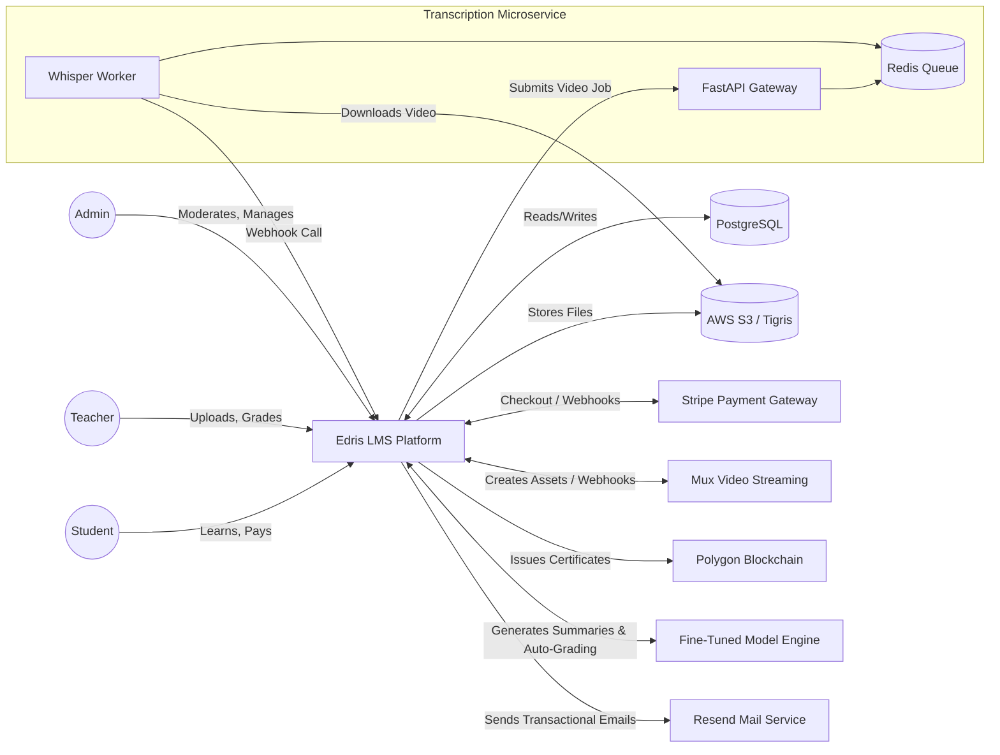
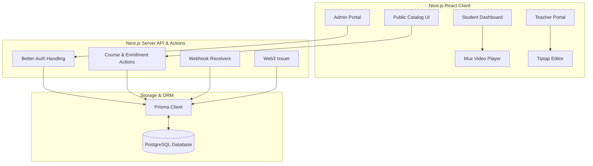
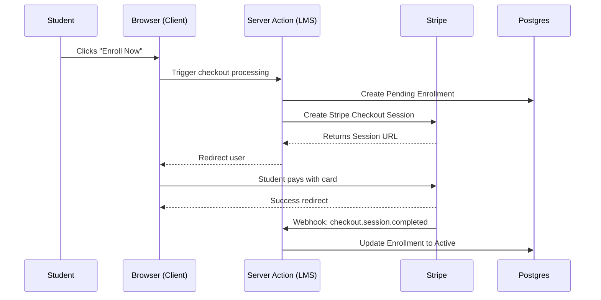
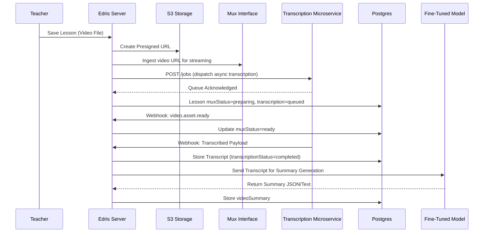
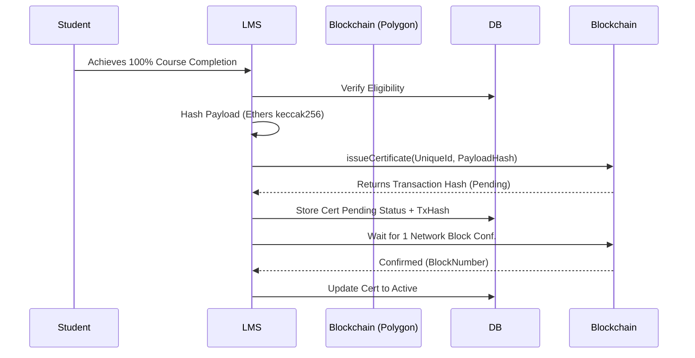
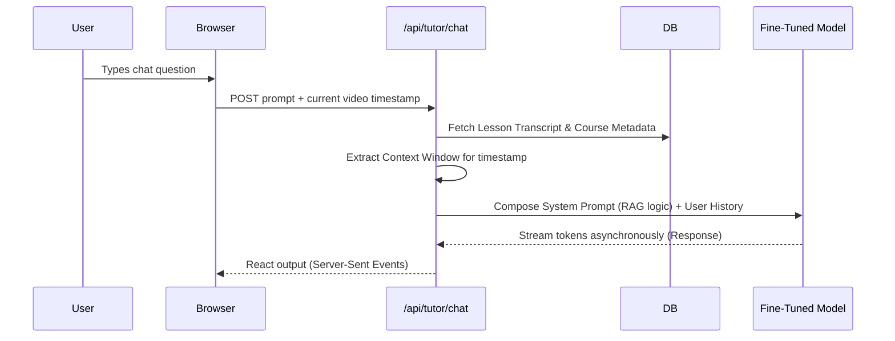
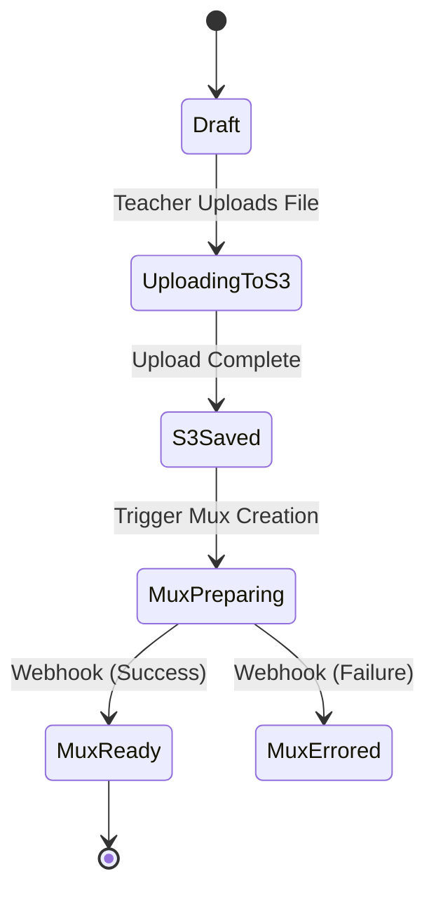
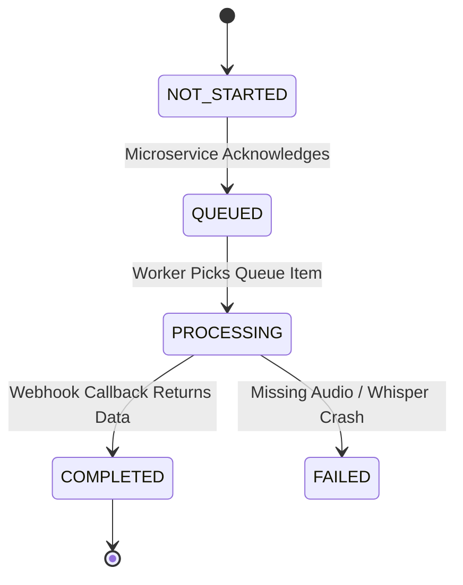
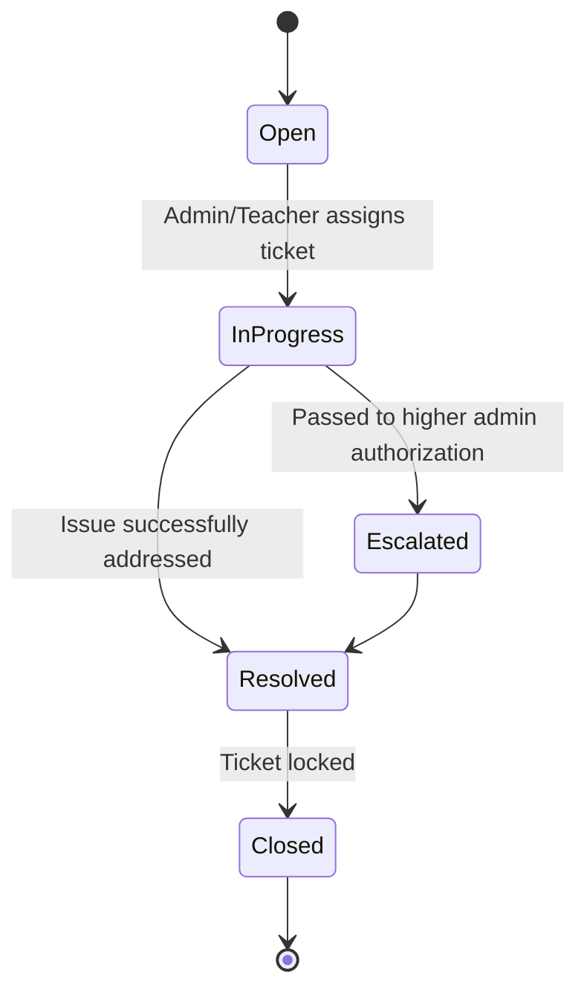
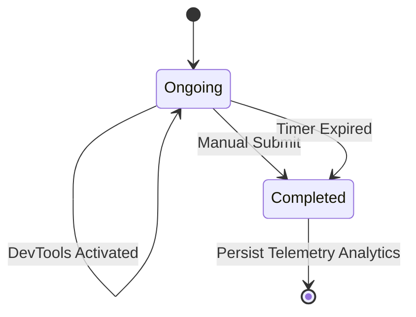

# Edris LMS: Comprehensive System Diagrams

This document contains all the architectural, sequence, state, and structural diagrams for the Edris LMS platform, visualised using Mermaid.js.

## 1. Context and Architectural Diagrams

### 1.1 High-Level Context Diagram


### 1.2 Component Diagram (LMS Internals)


---

## 2. Entity-Relationship (ER) Diagram

```mermaid
erDiagram
    user ||--o{ session : authenticates
    user ||--o{ enrollment : takes
    user ||--o{ assignment_submission : submits
    user ||--o{ support_ticket : raises/solves

    course ||--o{ enrollment : has
    course ||--o{ chapter : contains
    course ||--o{ cart_item : sold_as
    course ||--o{ certificate : issues

    chapter ||--o{ lesson : contains

    lesson ||--o{ lesson_attachment : includes
    lesson ||--o| quiz : features
    lesson ||--o| assignment : features
    lesson ||--o{ tutor_chat : contextualizes
    lesson ||--o{ lesson_progress : tracks

    quiz ||--o{ quiz_question : contains
    quiz_question ||--o{ quiz_option : provides
    user ||--o{ quiz_attempt : takes
    quiz_attempt ||--o{ quiz_answer : logs

    user {
        string id PK
        string email
        string role
        string stripeCustomerId
    }
    course {
        string id PK
        string title
        int price
        string status
    }
    lesson {
        string id PK
        string videoKey
        string muxAssetId
        string transcript
    }
    lesson_progress {
        string id PK
        boolean completed
        float watchPercentage
    }
```

---

## 3. Sequence Diagrams (Data Workflows)

### 3.1 Course Payment & Enrollment Flow


### 3.2 Video Processing & Transcription Flow


### 3.3 Blockchain Certificate Issuance Flow


### 3.4 AI Tutor RAG Chat Flow


---

## 4. State Machine Diagrams

### 4.1 Lesson Video Status Lifecycle


### 4.2 Transcription Pipeline Lifecycle


### 4.3 Support Ticket Lifecycle


### 4.4 Quiz Attempt Cheating Telemetry

