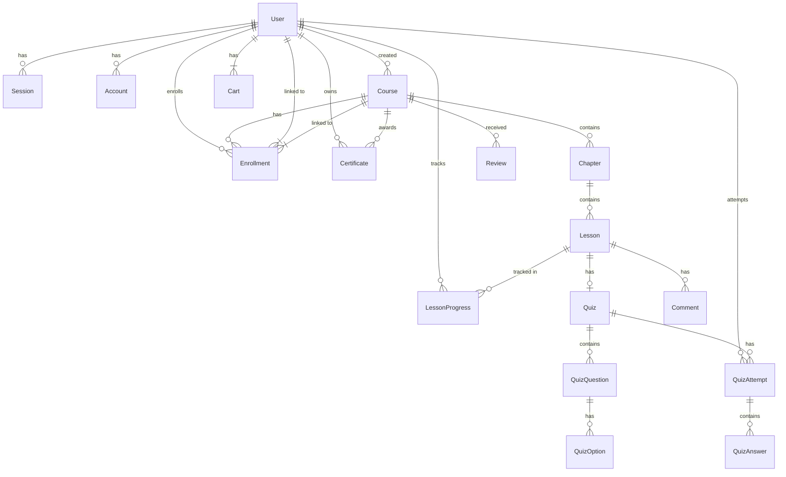
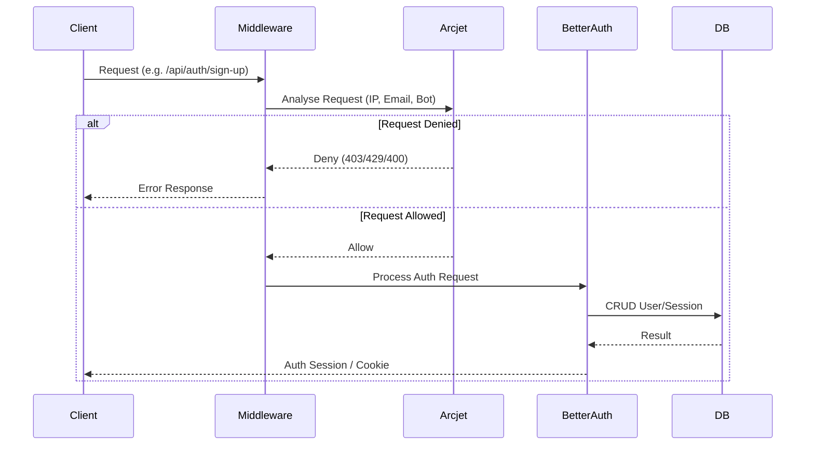
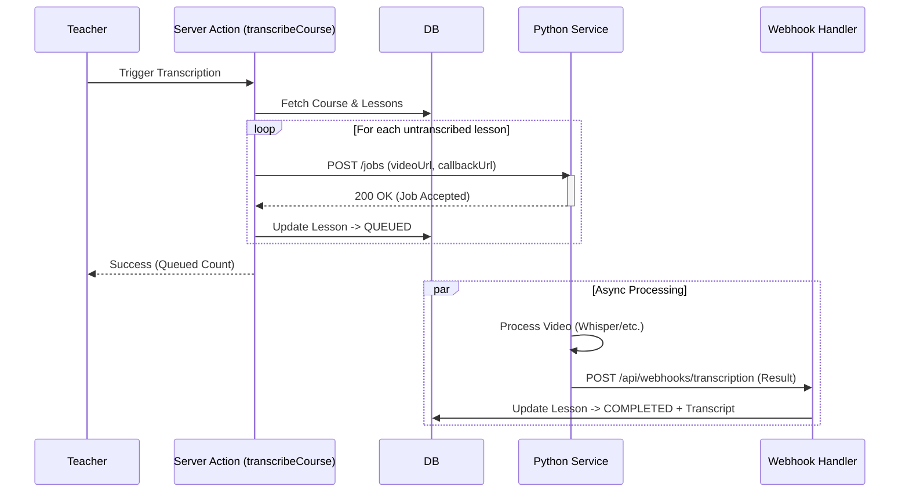
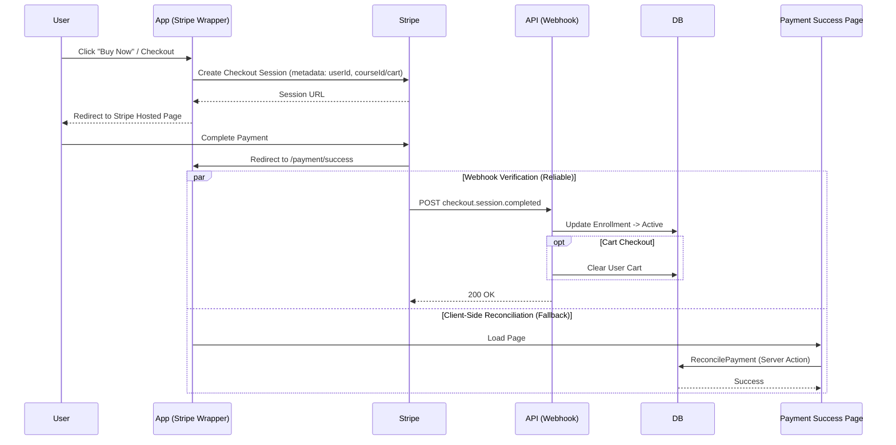
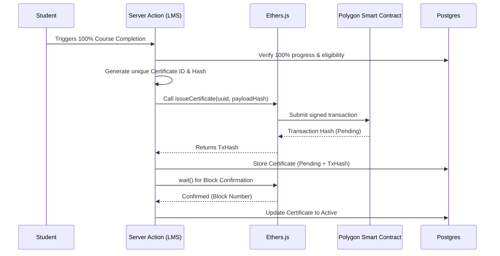

# Working Diagrams

This document contains architectural and workflow diagrams for the Edris LMS project, generated based on the current codebase.

## 1. High-Level System Architecture

This diagram shows the main components of the system and their interactions.

```mermaid
graph TD
    User[User / Client]
    Admin[Admin]
    
    subgraph "Next.js Application (Edris LMS)"
        UI[Frontend UI (React)]
        API[API Routes / Server Actions]
        Auth[Better Auth]
        Prisma[Prisma ORM]
    end
    
    subgraph "External Services"
        DB[(PostgreSQL Database)]
        Stripe[Stripe (Payments)]
        Arcjet[Arcjet (Security/Bot Protection)]
        S3[AWS S3 / Tigris (Object Storage)]
        Transcriber[Python Transcription Microservice]
        Blockchain[Polygon Blockchain]
    end

    User -->|HTTPS| UI
    Admin -->|HTTPS| UI
    
    UI -->|Server Actions| API
    API -->|Query| Prisma
    Prisma -->|SQL| DB
    
    API -->|Protect| Arcjet
    API -->|Auth| Auth
    
    API -->|Uploads| S3
    
    API -->|Checkout| Stripe
    Stripe -->|Webhook| API
    
    API -->|Submit Job| Transcriber
    Transcriber -->|Webhook| API
    Transcriber -->|Fetch Video| S3
    API -->|Issue Certificates| Blockchain
```

## 2. Database Schema (ERD)

This entity-relationship diagram represents the data models defined in `prisma/schema.prisma`.



## 3. Authentication Flow

This diagram illustrates how user requests are protected and authenticated.



## 4. Course Transcription Process

This diagram details the asynchronous transcription workflow involving the external Python microservice.



## 5. Payment & Reconciliation Flow

This diagram shows how Course and Cart purchases are handled via Stripe.



## 6. Admin Revenue Analytics

This diagram explains how revenue data is aggregated for the Admin Dashboard.

```mermaid
flowchart LR
    subgraph Database
        Enrollments[Enrollment Table]
    end
    
    subgraph AdminLogic [adminGetRevenueStats]
        Aggregation[DB Aggregation (Prisma)]
        Grouping[Data Grouping (JS)]
    end
    
    subgraph Dashboard
        StatsCards[Stats Cards]
        Chart[Revenue Chart]
    end
    
    Enrollments -->|Count & Sum (Active)| Aggregation
    Enrollments -->|Fetch Last 30 Days| Aggregation
    
    Aggregation -->|Raw Data| Grouping
    Grouping -->|Revenue Growth %| StatsCards
    Grouping -->|Daily Breakdown Map| Chart
```

## 7. Blockchain Certificate Issuance

This diagram illustrates the smart contract interaction for issuing immutable Web3 certificates upon course completion.


